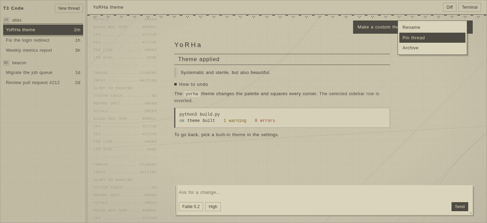
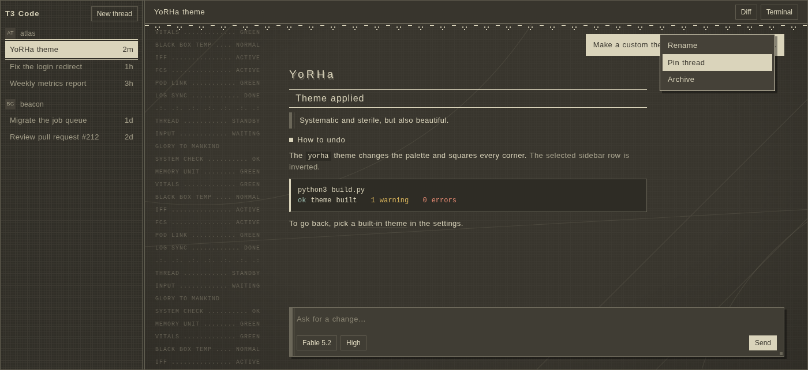

# YoRHa theme for T3 Code

A custom theme for T3 Code inspired by the menu interface of NieR: Automata.
It has a light variant based on the game's menu and a dark variant built from the same ink color.





The screenshots are static mockups built by `build.py`, not captures of the app.

## What it changes

- **Palette:** parchment background, lighter panels, dark ink bars and a single drab red-orange accent.
- **Selection:** the selected thread, highlighted menu items and your own messages are inverted, with a rule above and below the selected row.
- **Shape:** square corners on everything, thin borders and hard offset shadows on panels.
- **Ornament:** the dash-and-three-dots band under the chat header, a fine grid and a screen vignette.
- **Motion:** button fills sweep in from the left, menus open from a center line, the background linework drifts slowly and a faint system log scrolls in the left margin of the chat.

All motion stops when the system asks for reduced motion.

## Install

1. Download [`yorha.theme.json`](yorha.theme.json).
2. In T3 Code, open the appearance settings and add a theme from that file.
3. Select **YoRHa**. Switch the app between light and dark to see both variants.

The theme uses the system's Helvetica (or Nimbus Sans, Liberation Sans or Arial as fallbacks).
A font you picked in the T3 Code settings takes precedence.

## Build

`yorha.theme.json` is generated. Edit `yorha.css` or the palettes in `build.py`, then run:

```sh
python3 build.py
```

This rewrites `yorha.theme.json` and the HTML previews in `preview/`.
T3 Code limits a theme's CSS to 20,000 characters; the script prints the current size.

## Where the values come from

- The light palette was measured on the figures in the UI designer's article on the PlatinumGames blog,
  [UI Design in NieR:Automata](https://www.platinumgames.com/official-blog/article/9624).
- The grid size and the button fill follow the [metakirby5/yorha](https://github.com/metakirby5/yorha) stylesheet.
- The dark variant has no equivalent in the game. It is this theme's own extension.

## Notes

- The theme styles T3 Code through the selectors its theme guide documents as stable.
  It was checked on the T3 Code nightly of November 2026 and may need updates after app releases.
- This is an unofficial fan project. It is not affiliated with or endorsed by Square Enix or PlatinumGames.
  NieR: Automata is a trademark of Square Enix. The repository contains no assets from the game.

## License

[MIT](LICENSE)
